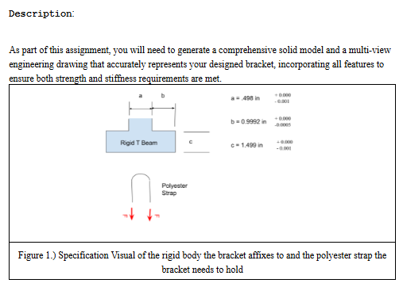
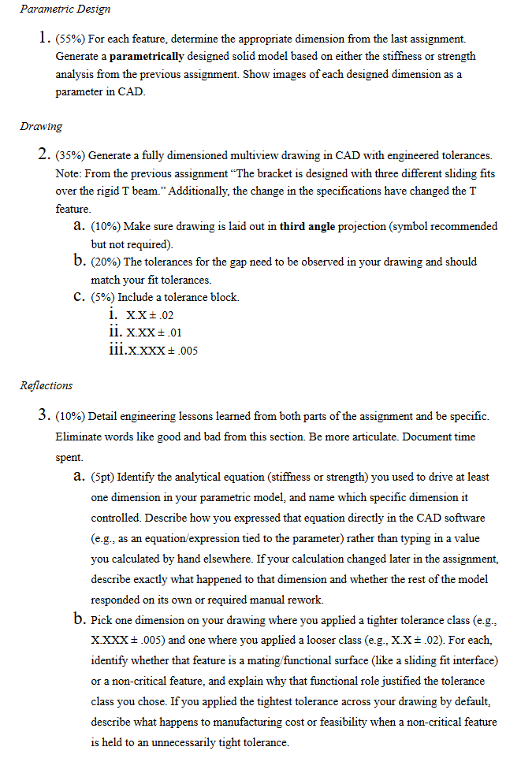
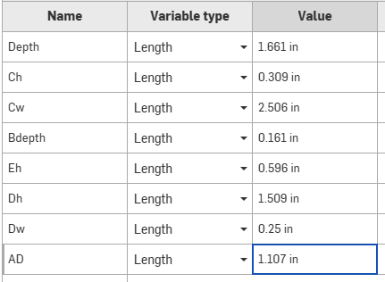
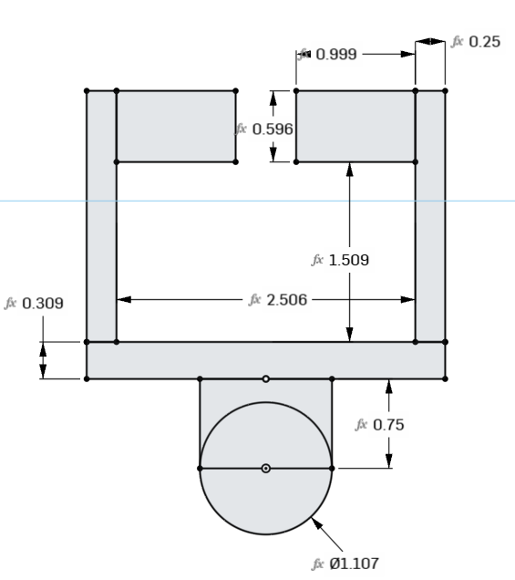
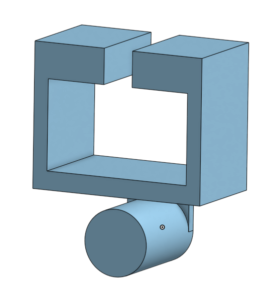
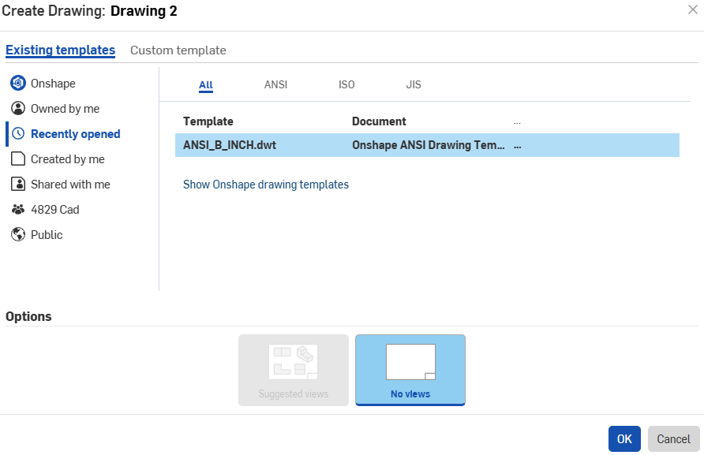
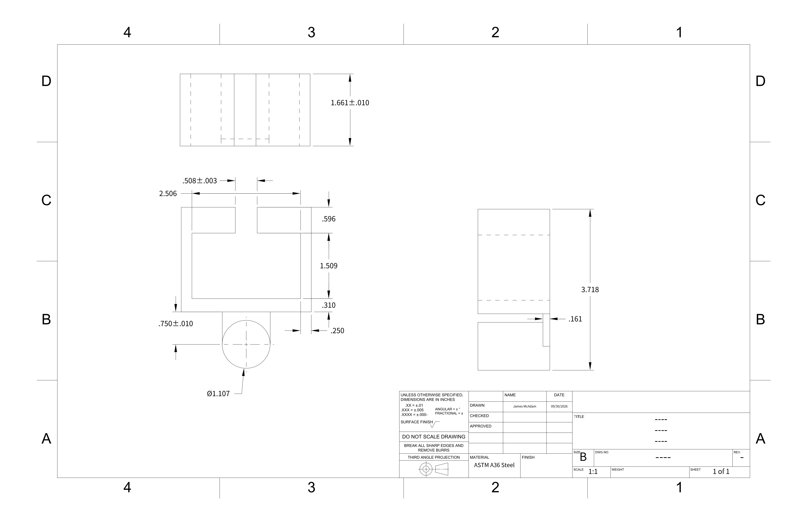

# A6 – Bracket Drawing

## Objective

- Generate a parametrically designed solid model based on the stiffness or strength analysis from the previous assignment, showing each designed dimension as a parameter in CAD.
- Generate a fully dimensioned multiview drawing in third angle projection with engineered tolerances and a tolerance block.
- Detail engineering lessons learned from both parts and document time spent.

<figure style="margin:0;"><figcaption style="margin-top:.45em; font-size:.72rem; line-height:1.4; text-align:center; color:var(--md-default-fg-color--light);">Specification of the rigid T beam the bracket slides over and the polyester strap it holds.</figcaption></figure><figure style="margin:0;"><figcaption style="margin-top:.45em; font-size:.72rem; line-height:1.4; text-align:center; color:var(--md-default-fg-color--light);">Assignment rubric: parametric design, drawing, and reflections.</figcaption></figure>

## Analyze

### Parametric Model

I pulled dimensions from A5 and made a 3d model of it. It was just one sketch with 2 extrusions, one at .161 inches for part B and one at 1.616 in for the T bar hanger and the pin. I threw all dimensions into the table and made the drawing and executed both of those.

<figure style="margin:0;"><figcaption style="margin-top:.45em; font-size:.72rem; line-height:1.4; text-align:center; color:var(--md-default-fg-color--light);">Onshape variable table holding each designed dimension from A5.</figcaption></figure><figure style="margin:0;"><figcaption style="margin-top:.45em; font-size:.72rem; line-height:1.4; text-align:center; color:var(--md-default-fg-color--light);">Profile sketch with every dimension tied to a variable (fx).</figcaption></figure><figure style="margin:0;"><figcaption style="margin-top:.45em; font-size:.72rem; line-height:1.4; text-align:center; color:var(--md-default-fg-color--light);">Finished solid model after the two extrusions.</figcaption></figure>

### Drawing

After this I used the ANSI B IN template in onshape and inserted the part. I arranged it in third angle projection with the top view up above, the right view to the right, and the front view in the bottom left. I made sure nothing was dimensioned twice and tried to give dimensions that would be easy to test rather than the dimensions that were easy to design with. 

<figure style="margin:1.6em 0; text-align:center;">
  
  <figcaption style="margin-top:.6em; font-size:.75rem; line-height:1.45; color:var(--md-default-fg-color--light);">Starting the drawing from the ANSI B inch template with no suggested views, so I could place each view myself.</figcaption>
</figure>

## Time Spent

I spent a total of three and a half hours on this assignment.

## Lessons Learned

I had made engineering drawings before but I gave more consideration to helping the machinist measure for QC. I also was able to finish the whole process of a part from stress calculations to a cad model with drawings.

## AI Disclosure

Claude was used to lay out this page — placing the figures, writing the image captions, adding the section headings, and adding the front matter that drives the homepage card — and to convert my Onshape DXF export into the drawing image and PDF. It also pointed out items to check on the drawing. The parametric model, the variable table, the drawing, and the tolerances are mine. Session summaries are on the [AI Disclosure](../../ai-disclosure.md) page.

## Communicate

<figure style="margin:1.6em 0; text-align:center;">
  
  <figcaption style="margin-top:.6em; font-size:.75rem; line-height:1.45; color:var(--md-default-fg-color--light);">Bracket drawing in third angle projection, ANSI B, 1:1, ASTM A36 steel. Download: <a href="bracket-drawing.pdf">PDF</a> · <a href="Drawing.dxf">DXF</a></figcaption>
</figure>
