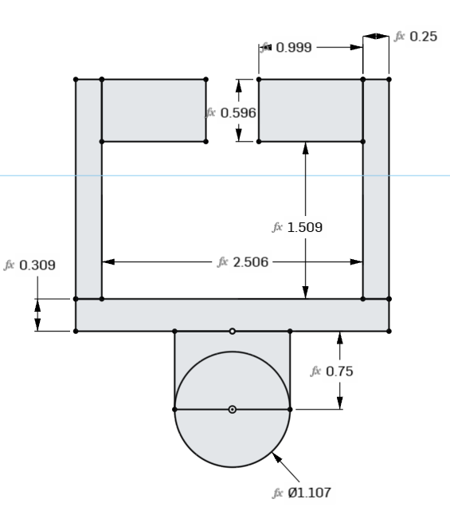
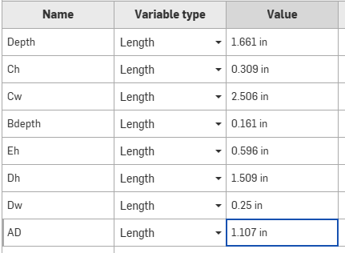
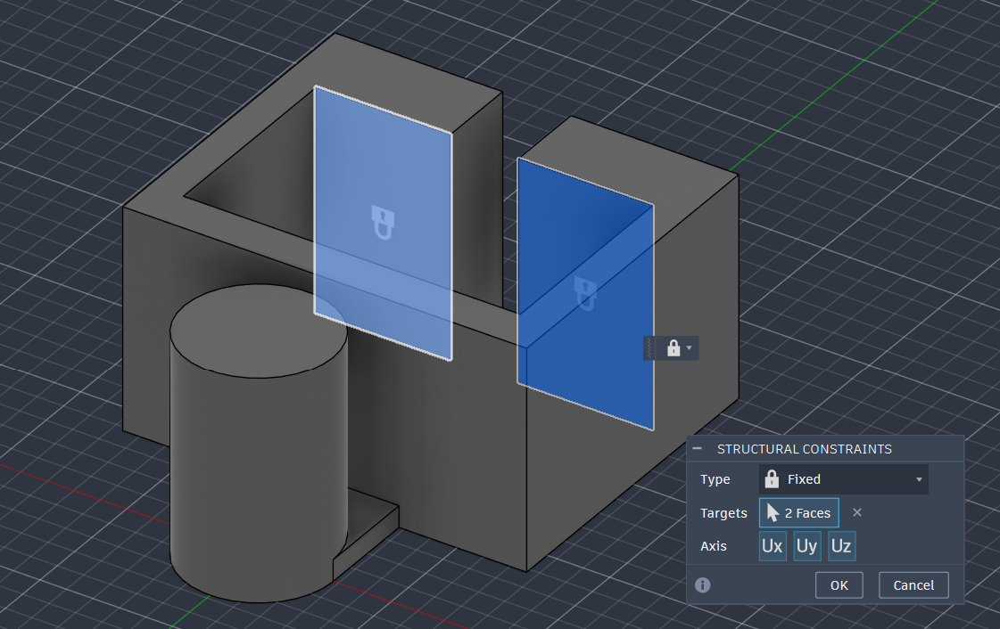
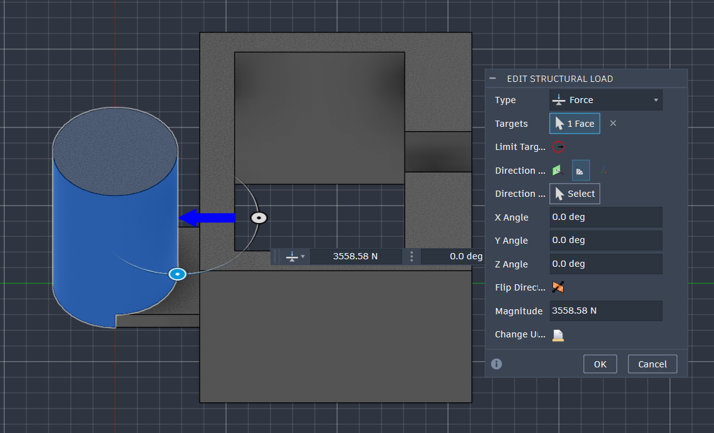
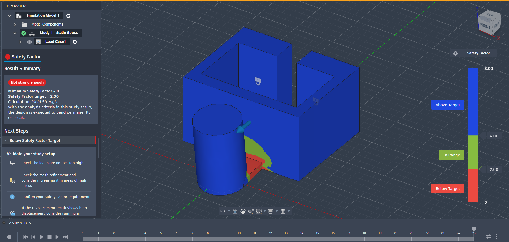
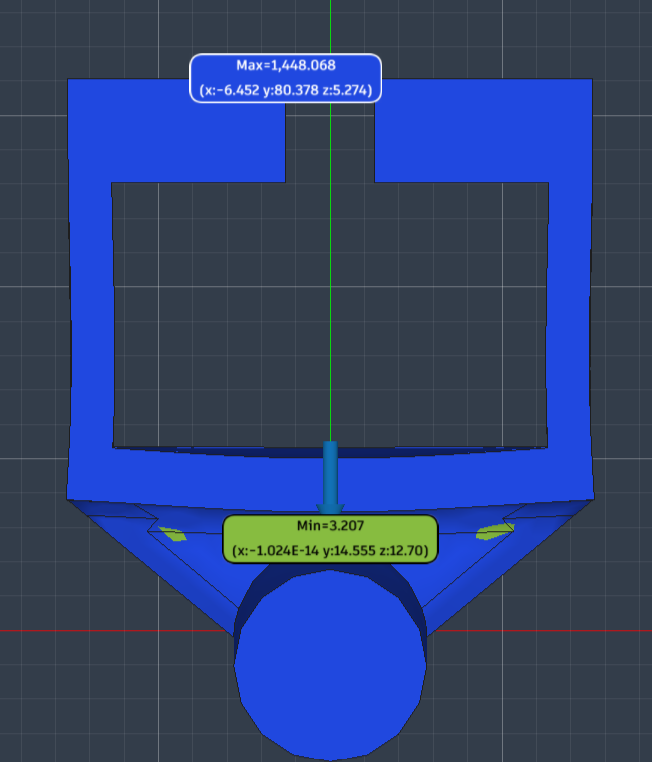
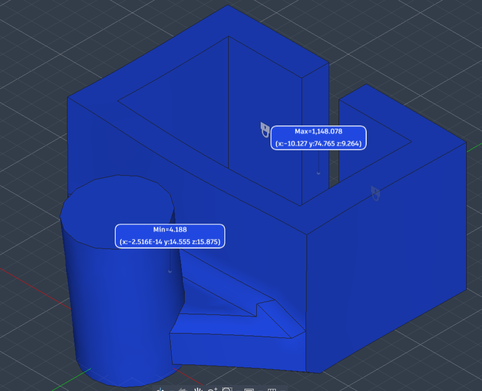

# A7 – Bracket FEA

## Objective

- Take the bracket from [A5](../A05/index.md) and [A6](../A06/index.md) into static FEA and use it to make the bracket stiffer, stronger, and lighter over at least three designs, without changing the material.
- For each design, set up the constraints, load and mesh, solve, interpret the safety factor, max stress and max displacement, refine the mesh until the results change by less than 7%, and decide what geometry to change next.
- Detail engineering lessons learned and document time spent.

| | Design 1 | Design II | Design III |
| --- | --- | --- | --- |
| Max Stress and location | 763.33 MPa in member B | 77.393 MPa at the top of member B | 59.226 MPa at the top of member B |
| Max deflection and location | 0.962 mm at the tip of the pin | 0.057 mm at the tip of the pin | 0.039 mm at the tip of the pin |
| mass | 0.891 kg | 0.95 kg | 1.021 kg |
| Safety Factor | Min 0.325 in member B | 3.207 in member B | 4.188 in member B |
| Number of elements | TODO | TODO | TODO |

## Design 1

### Preprocessing

I started with the design I made in A5 and 6. This design was supposed to take 800 lbf at the hanger with a safety factor of four. This only accounts for strength as that was the ruling dimensioning requirement other than the member between the pin and the bracket. FEA will likely highlight that as the weakest part because it accounts for both strength and stiffness. Below are pictures of the dimensions.

<figure style="margin:0; break-inside:avoid;"><figcaption style="margin-top:.45em; font-size:.72rem; line-height:1.4; text-align:center; color:var(--md-default-fg-color--light);">Design 1 profile sketch carried over from A6, every dimension tied to a variable.</figcaption></figure><figure style="margin:0; break-inside:avoid;"><figcaption style="margin-top:.45em; font-size:.72rem; line-height:1.4; text-align:center; color:var(--md-default-fg-color--light);">Design 1 variable table, with member B (Bdepth) at 0.161 in.</figcaption></figure>

I exported it from onshape as a step file then opened it in fusion. Once in fusion, I switched to the simulation tab and fixed the flanges from the bottom as that is what will be braced against the rail. I applied a load of 800 lbf at the center of the lower pin and clicked solve.

<figure style="margin:0; break-inside:avoid;"><figcaption style="margin-top:.45em; font-size:.72rem; line-height:1.4; text-align:center; color:var(--md-default-fg-color--light);">Fixed constraint on two faces of the top flanges, locking Ux, Uy and Uz.</figcaption></figure><figure style="margin:0; break-inside:avoid;"><figcaption style="margin-top:.45em; font-size:.72rem; line-height:1.4; text-align:center; color:var(--md-default-fg-color--light);">The 800 lbf load entered as a 3558.58 N force on the pin face.</figcaption></figure>

**TODO:** mesh settings for Design 1 (element size / type and any local refinement), and the material assigned in Fusion.

### Computation

I solved the setup as a static stress study in Fusion (Study 1 – Static Stress).

### Data Interpretation

As expected, the member between the pin and bracket was far too weak. It had a safety factor of 0.325 so it would certainly break.

<figure style="margin:1.6em 0; text-align:center; break-inside:avoid;">
  
  <figcaption style="margin-top:.6em; font-size:.75rem; line-height:1.45; color:var(--md-default-fg-color--light);">Design 1 safety factor plot: below target (red) at member B where the pin meets the bracket, everything else above 4.</figcaption>
</figure>

Max stress was 763.33 MPa in member B, max deflection was 0.962 mm at the tip of the pin, and the minimum safety factor was 0.325 in member B.

### Error Estimation

| Mesh # | Element size | Number of elements | Max stress | Max displacement | SF | % change vs. previous mesh |
| --- | --- | --- | --- | --- | --- | --- |
| 1 | TODO | TODO | TODO | TODO | TODO | — |
| 2 | TODO | TODO | TODO | TODO | TODO | TODO |
| 3 | TODO | TODO | TODO | TODO | TODO | TODO |

**TODO:** mesh refinement results for Design 1, and whether it converged within 7% or hit the three-attempt limit.

### Design Optimization

I went back in and thickened it from .1605 inches to .5 inches. I'm thinking that design 2 will get the safety factor to an acceptable level all around and design 3 will cut back down where it's overly built for the 3rd design.

## Design II

### Preprocessing

Member B goes from .1605 inches to .5 inches. The fixed flange faces and the 800 lbf load on the pin stay the same as Design 1.

**TODO:** mesh settings for Design II.

### Computation

I re-solved the static stress study with the updated geometry.

### Data Interpretation

The third design came with a safety factor of 3.207. This is still not as high as I would like it to be but the member is quite large there.

<figure style="margin:1.6em 0; text-align:center; break-inside:avoid;">
  
  <figcaption style="margin-top:.6em; font-size:.75rem; line-height:1.45; color:var(--md-default-fg-color--light);">Design II safety factor plot: minimum 3.207 in the thickened member B, under the load arrow.</figcaption>
</figure>

Max stress was 77.393 MPa at the top of member B and max deflection was 0.057 mm at the tip of the pin.

### Error Estimation

| Mesh # | Element size | Number of elements | Max stress | Max displacement | SF | % change vs. previous mesh |
| --- | --- | --- | --- | --- | --- | --- |
| 1 | TODO | TODO | TODO | TODO | TODO | — |
| 2 | TODO | TODO | TODO | TODO | TODO | TODO |
| 3 | TODO | TODO | TODO | TODO | TODO | TODO |

**TODO:** mesh refinement results for Design II, and whether it converged within 7% or hit the three-attempt limit.

### Design Optimization

I would like to trim down the top portion for the third design. I tried to use a lightening feature to pocket some areas but it ended up being too much for the safety factor to handle. I made member b just a little bit thicker at .625 inches to try to bring the safety factor up to 4.

## Design III

### Preprocessing

Member B goes from .5 inches to .625 inches. The fixed flange faces and the 800 lbf load on the pin stay the same as Design 1.

**TODO:** mesh settings for Design III.

### Computation

I re-solved the static stress study with the updated geometry.

### Data Interpretation

With these changes, we were fully in the clear with a safety factor above 4.

<figure style="margin:1.6em 0; text-align:center; break-inside:avoid;">
  
  <figcaption style="margin-top:.6em; font-size:.75rem; line-height:1.45; color:var(--md-default-fg-color--light);">Design III safety factor plot: minimum 4.188 in member B, with the whole part above target.</figcaption>
</figure>

Max stress was 59.226 MPa at the top of member B and max deflection was 0.039 mm at the tip of the pin.

### Error Estimation

| Mesh # | Element size | Number of elements | Max stress | Max displacement | SF | % change vs. previous mesh |
| --- | --- | --- | --- | --- | --- | --- |
| 1 | TODO | TODO | TODO | TODO | TODO | — |
| 2 | TODO | TODO | TODO | TODO | TODO | TODO |
| 3 | TODO | TODO | TODO | TODO | TODO | TODO |

**TODO:** mesh refinement results for Design III, and whether it converged within 7% or hit the three-attempt limit.

### Design Optimization

I am happy with this design however I did see there was a tab for generative design which would have been neat to compare with for this project.

## Reflections

While the part got heavier through every design, I would still consider this optimized for weight as I took mass away from the overbuilt parts and added it to the weaker members.

- Member B was the weak point the whole way through. In A5 I sized it for axial stress and assumed it wouldn't see bending, and the FEA showed the pin load bends it right where it meets the bracket, which is why Design 1 came in at a safety factor of 0.325.
- Material placed in the critical member did far more than material anywhere else. Going from .1605 to .5 inches on member B cut max stress from 763.33 MPa to 77.393 MPa and deflection from 0.962 mm to 0.057 mm for 0.059 kg of added mass.
- The max stress stayed at the top of member B in all three designs, so each change targeted that one spot instead of the whole part.
- Pocketing the top portion took the safety factor below target, so the parts that look overbuilt on the plot still carry load into member B.
- A safety factor of 4 from hand calculations doesn't carry over to FEA on its own; the hand calcs model each member separately, and the FEA picks up the junctions between them.

Time spent: 3 hours.

## CAD Download

- <a href="Part%20Studio%201%20%285%29.step" download>Download the final bracket model, Design III (STEP)</a>

## AI Disclosure

Claude Code laid out this page from my writeup and screenshots: the headings, figures, captions, and tables. It also wrote the Objective, the short Computation and Design II/III setup notes, the one-line result summaries, and the lessons-learned bullets in Reflections, all from my results. The modeling, FEA, results, design decisions, and the rest of the writeup are mine. Session summaries are on the [AI Disclosure](../../ai-disclosure.md) page.
